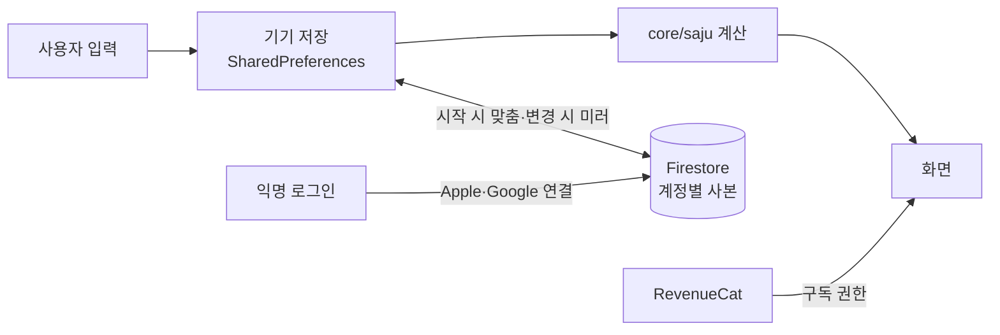
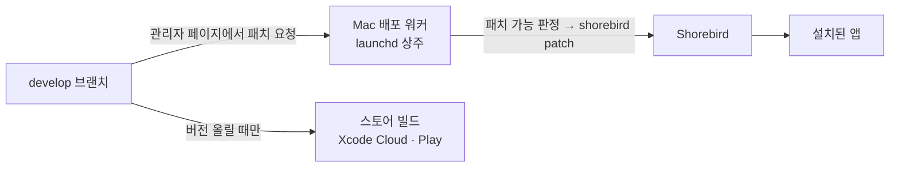
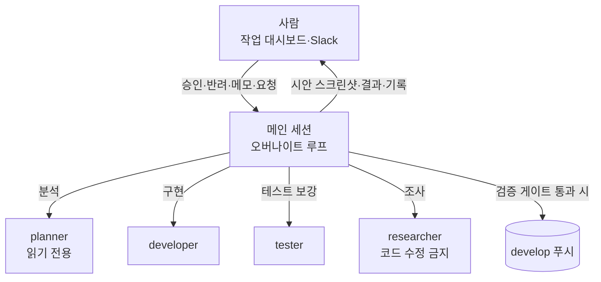

# 사주랑 — 아키텍처와 AI 하네스 설계

> 사주(명리) 앱 **사주랑**을 만들며 설계한 앱 아키텍처와, 혼자서 4개월 동안 3천 번 넘게 커밋할 수 있게 해 준 AI 개발 하네스를 소개합니다.
> 앱 소스는 공개하지 않습니다. 이 문서는 구조와 방법만 다룹니다.

## 한눈에

- **기간**: 2026년 7월 ~ 진행 중(약 4개월), 1인 개발 + Claude Code 에이전트
- **커밋**: 3,190개 이상 — 대부분 사람이 자는 동안 도는 자동 개발 루프가 만듦
- **코드**: 앱 Dart 약 9.2만 줄(427개 파일), 테스트 약 24만 줄(663개 파일, 테스트 약 1만 2천 개) — 테스트가 앱 코드의 2.6배
- **계산 기준**: 문서로 고정한 판정 기준 91개, 기준마다 출처·근거 구절·앱 코드 위치를 적고 테스트로 묶음
- **스택**: Flutter · Riverpod · GoRouter · Freezed · Firebase(Auth·Firestore·Hosting·Functions·Remote Config) · RevenueCat · Shorebird 코드 푸시

## 1. 무엇을 만드는가

생년월일시를 넣으면 사주팔자(네 기둥)를 세우고, 그 위에 리포트·오늘의 운세·궁합·택일(결혼·이사·개업 좋은 날)·이름 풀이를 얹는 앱입니다.

이 도메인의 어려움은 화면보다 **계산**에 있습니다.

- 절기 시각이 분 단위로 맞아야 월주가 맞고, 자정·23시 근처에서는 학파마다 날짜가 갈립니다.
- 한국의 옛 표준시(UTC+8:30), 서머타임, 진태양시(경도 보정)를 모두 처리해야 합니다.
- 같은 판정도 원전(옛 책)·한국 실무·인터넷 정리본이 서로 다르게 말합니다.

그래서 이 프로젝트의 원칙은 **"쉽고 재밌는 풀이를, 언제나 정확한 계산 위에"**입니다. 풀이 문구는 동화책처럼 쉽게 쓰되 계산 정확성은 양보하지 않고, 둘 다 UI 다듬기보다 앞에 둡니다. 아키텍처와 AI 하네스 모두 이 원칙을 지키도록 짜여 있습니다.

## 2. 앱 아키텍처

### 폴더 구조

```
lib/
├── app/        앱의 틀 — 테마, 라우팅(GoRouter), 시작 시 서버 맞춤
├── core/       화면과 무관한 도구 상자
│   ├── saju/     사주 계산 엔진(순수 함수만, 앱의 심장부)
│   ├── content/  화면에 얽매이지 않는 풀이 문구 데이터
│   ├── firebase/ 서버 연결·서버 사본(미러) 공통 도구
│   └── billing/  구독 상태
├── features/   화면 단위 기능 24개(리포트·운세·궁합·택일·이름 풀이·구독…)
│   └── <기능>/  domain(판정·문구) / data(저장소) / presentation(화면·Riverpod)
└── shared/     여러 기능이 같이 쓰는 위젯·공유·알림
```

### 계산 엔진은 순수 함수, 결과는 결정적

- `core/saju`는 Flutter·서버를 전혀 모르는 순수 Dart입니다. 입력이 같으면 출력도 항상 같아야 하고, 무작위·시드·로테이션 요소는 금지입니다.
- 풀이 문구(캐릭터화·말투)는 자유롭게 바꿀 수 있지만, 언제나 고정된 계산 결과 위에 얹습니다.
- 계산 결과가 바뀌는 수정은 "바뀌는 구간"을 테스트로 고정하고, 그 밖의 결과는 그대로인지 전수 대조합니다(예: 1990~2030년 모든 날짜 × 택일 목적 3개).

### 데이터 흐름 — 기기 우선, 서버는 미러



- 처음엔 로그인 없이 익명 계정으로 시작하고, 나중에 Apple·Google 계정을 연결하면 같은 계정 ID로 이어집니다.
- 화면은 기기 데이터만 보고 그립니다. 서버 사본은 기기를 바꾸거나 다시 설치했을 때 복원하는 용도입니다. 깨진 서버 문서 하나는 그 문서만 건너뛰어, 앱 전체 복원이 실패하지 않게 합니다.
- 본인 정보는 모두 무료이고, 다른 사람 추가(본인 + 1명 초과)만 구독입니다. 인원 한도는 Remote Config로 조정합니다.

### 배포 — 스토어 빌드와 코드 푸시를 나눔



- `develop`은 곧 코드 푸시(Shorebird 패치)의 기준입니다. 그래서 패치로 보낼 수 없는 변경(네이티브·에셋·글꼴·플러그인·버전 번호)은 develop에 넣지 않고 다음 스토어 빌드로 미룹니다.
- 관리자 웹 페이지(Firebase Hosting)에서 패치를 요청하면, Mac에 상주하는 Node 워커가 Firestore 구독으로 요청을 받아 "패치 가능 여부"를 판정하고 빌드·배포·결과 기록까지 합니다. 판정 로직은 순수 모듈로 분리해 단위 테스트합니다.
- Cloud Functions는 Apple 서버 알림·계정 삭제 정리 같은 서버 몫만 맡습니다.

## 3. 정확성을 지키는 장치

### 출처 위계가 있는 계산 기준표

모든 계산·판정 항목은 `계산_기준표`에 기준 번호(현재 91개)로 적습니다. 기준을 정하는 순서가 정해져 있습니다.

1. 천문·역법·시간(절기 시각, 음력, 서머타임, 옛 표준시)은 **공식 자료**(한국천문연구원·정부 기록)
2. 사주 판정은 **한국 기준** 우선
3. 한국 기준이 없거나 갈리면 **원전**(옛 원본 책)
4. 원전에도 없으면 **서로 독립된 출처 3곳 이상**이 같은 방식을 쓸 때만 "통용 기준"으로 인정
5. 그래도 없으면 **판정하지 않음** — 블로그 한두 곳으로 빈칸을 채우지 않음

한국 기준과 원전 결과가 실제로 다른 사용자에게만 결과 옆에 "기준에 따라 달라요 ⓘ"를 띄우고, 누르면 원전 결과를 보여 줍니다.

### 문서와 코드가 어긋나지 않게 묶는 테스트

- 기준표의 "앱 코드 위치"가 실제 함수·파일과 맞는지, 앱 안 "계산 기준 안내" 화면이 기준표와 같은 내용인지를 테스트가 대조합니다. 문서를 고치고 앱을 안 고치면(또는 그 반대면) 빌드가 깨집니다.
- 절기표는 한국천문연구원 원본 파일에서 기계로 생성하고, 원본 SHA-256과 생성 결과를 테스트로 고정합니다. 1920~2100년 4,344개 절입 시각을 JPL 궤도표로 따로 계산해 독립 대조도 했습니다.

### 시간대 불변성 — 여섯 개 시간대에서 같은 결과

사주는 "한국 시각" 기준인데 기기는 전 세계 어디에나 있을 수 있습니다. 표준 검사 스크립트는 서울 외에 뉴욕(서머타임)·산티아고·로드하우(30분 서머타임)·아피아·키리티마티(UTC+14)로 시간대를 바꿔 같은 테스트를 다시 돌립니다. 실제로 이 회차에서 "기기 시간대의 서머타임 시작일에 태어난 시간 02:30이 03:30으로 밀려 시주가 바뀌는" 버그를 찾아 고쳤습니다.

### 한 번에 도는 검증 게이트

`check_build.sh` 하나가 의존성 → 코드 생성 → 린트 → 포맷 → 테스트(여러 시간대) → 빌드 → 산출물 확인을 차례로 돌리고, 실패하면 그 단계에서 멈춥니다. 자동 루프는 `검사 성공 && 커밋 && 푸시`로만 묶어 씁니다 — 검사를 통과하지 못한 코드는 원격에 올라가지 않습니다.

## 4. AI 하네스 설계

사람 한 명이 하루 몇 시간만 보면서도 앱이 계속 자라도록, Claude Code 위에 **규칙 · 역할 · 루프 · 사람의 창구**를 얹었습니다.



### 헌법 — 규칙 파일 하나

저장소 루트의 `CLAUDE.md`에 규칙 19개가 있습니다. 모든 세션과 서브 에이전트가 이 규칙을 먼저 읽습니다. 몇 가지 예입니다.

- 1순위는 쉽고 풍부하고 재밌는 풀이, 그 바탕인 계산 정확성은 양보하지 않음(규칙 10), 같은 입력이면 같은 결과(규칙 7)
- 계산 기준은 출처 위계를 따르고 기준표에 근거와 함께 적는다(규칙 15)
- UI가 바뀌는 작업은 **변경 전·예정 스크린샷**을 대시보드에 붙여 남긴다(규칙 4)
- 첫 화면 문장은 한자어 없이 초등학생도 알아듣게, 자세한 근거는 '자세히 보기' 안에(규칙 18), 전문 용어는 그 자리에서 뜻을 볼 수 있게(규칙 14)
- 태블릿·폴더블·듀얼 화면에서는 넓은 화면을 살린 배치를, 접히는 줄에는 글이 걸치지 않게(규칙 19)
- 모든 마크다운 문서는 한국어로, 표 대신 제목과 불릿으로(규칙 2·12)

규칙마다 "언제, 왜 생겼는지"는 커밋 이력에 남기고, 규칙 파일에는 현재 규칙만 둡니다. 사용자가 방향을 바꾸면 규칙 자체를 고쳐서, 다음 세션이 같은 실수를 하지 않게 합니다.

### 역할이 나뉜 서브 에이전트 4종

- **planner** — 읽기 전용. 요구사항을 분석하고 코드 지도(`PROJECT_ROUTER.md`)에서 경로를 찾아 계획을 냅니다. 리팩터링 후보 탐색도 맡습니다.
- **developer** — 구현하고, 고친 부분의 테스트·린트까지 책임집니다. 커밋은 하지 않습니다.
- **tester** — 테스트를 보강합니다. "코드를 일부러 되돌려 테스트가 실패하는지 보고, 다시 고쳐 통과하는지 확인"하는 절차를 반드시 거칩니다. 통과만 하는 테스트를 막기 위해서입니다.
- **researcher** — 원전·공식 자료·경쟁 앱을 조사해 리서치 문서를 갱신합니다. 앱 코드는 절대 고치지 않고, 결과는 정해진 형식의 커밋 메시지로 남깁니다.

에이전트끼리는 서로 부르지 않습니다. 메인 세션이 결과를 받아 다음 단계로 넘기고, 전체 검증과 커밋·푸시는 메인 세션만 합니다.

### 오버나이트 루프 — 스스로 다음 사이클을 예약

메인 세션은 한 사이클을 마치면 스스로 다음 사이클을 예약합니다(`ScheduleWakeup`). 한 사이클은 이렇게 돕니다.

1. 사람의 회신·코멘트·메모·Slack 요청을 먼저 확인하고, 대시보드 상태를 최신으로 맞춤
2. 승인된 작업 → 작업 대기 순서대로 처리(규모가 있으면 planner → developer → tester)
3. 할 일이 없으면 **리팩터링 후보 탐색**과 **리서치 회차**를 번갈아 진행
4. 검증 게이트(`check_build.sh`) 통과 시에만 기능 단위로 커밋·푸시
5. 실행 기록·자동 결정·문제를 대시보드에 남기고 바로 다음 사이클로

둘 다 낼 것이 없을 때만 30분 쉬고, 쉬기 시작할 때 Slack으로 한 번 알립니다. 할 일이 있으면 기다리지 않고 바로 이어 갑니다.

### 사람의 창구 — 작업 대시보드

사람과 루프는 공유 데이터베이스가 붙은 웹 대시보드 한 곳에서 만납니다.

- **회신 대기** — UI가 바뀌는 시안(변경 전·예정 스크린샷), 기준 변경, 새 콘텐츠 아이디어. 사람은 "승인/반려"만 누르면 됩니다.
- **작업 대기·진행 중·완료** — 끝난 항목은 지우지 않고 결과 한 줄과 커밋 해시를 남겨 그대로 이력이 됩니다.
- **결정 필요** — 외부 계정·비용·비밀값처럼 루프가 할 수 없는 일. 루프는 필요한 것만 적고 멈춥니다.
- **루프·리서치 기록** — 사이클마다 한 일, 자동 결정과 그 이유, 실패.
- **승인 절차 스위치** — 꺼 두면 루프가 규칙과 디자인 가이드로 추천안을 골라 스스로 결정해 바로 반영하고, 결정과 이유·스크린샷을 남깁니다(사람은 나중에 코멘트로 고칠 점만 남기면 됨). 켜면 시안을 회신 대기로 올리고 사람 승인을 기다립니다. 단, 가격·무료 범위 같은 사업 결정과 새 콘텐츠 아이디어는 스위치와 무관하게 늘 사람이 정합니다.

승인을 기다리는 시안은 저장소 밖 작업 폴더에서 만들고 `git stash`로 보관합니다. 승인되면 적용 → 검증 → 커밋, 반려되면 버립니다.

### 실패에서 생긴 규칙들

하네스는 처음부터 완성된 게 아니라, 루프가 실패할 때마다 규칙이 하나씩 늘었습니다.

- **리서치 커밋이 빌드를 깨뜨림** → 리서치가 기준표를 고치면 문서 대조 테스트를 반드시 돌린다는 규칙 추가
- **에이전트가 다른 Flutter 버전으로 테스트를 돌려 캐시가 꼬임** → 모든 에이전트 지시문에 SDK 경로 고정, 메인 검증 중에는 테스트 금지
- **대시보드 상태값이 정해진 값 밖으로 나가 항목이 어느 목록에도 안 보임** → 매 사이클 "끝나지 않은 항목 전체"를 읽어 상태를 바로잡는 단계 추가
- **할 일이 없다며 루프가 계속 쉼** → 쉬기 전에 리팩터링·리서치를 먼저 소진하도록 순서 변경
- **탐색이 "안 쓰는 코드"라고 잘못 짚음** → 구현 에이전트가 지우기 전에 호출부를 다시 확인하고, 틀리면 하지 않고 보고
- **이미 사람이 내린 결정과 반대되는 리서치 제안** → 기준표에 기록된 사용자 결정과 부딪히면 루프가 바꾸지 않고 기록만 남김

## 5. 리서치를 코드처럼 다루기

`docs/research/`의 도메인 문서(사주·궁합·이름·MBTI·시장·스토어 정책)는 "교본 수준"을 목표로 관리합니다.

- 항목마다 여러 독립 출처로 교차검증하고, 학파·해석 갈래까지 정리합니다.
- 문서마다 `최종 확인` 날짜가 있어, 오래된 문서부터 다시 확인합니다.
- 리서치 결과는 `발견:` / `앱 반영 후보:` 같은 정해진 줄 형식의 커밋으로 남기고, 다음 사이클이 그 커밋을 대시보드 리서치 탭으로 옮깁니다.
- 리서치가 앱 계산과 다른 점을 찾으면 그대로 작업 후보가 됩니다. 예: 택일의 복단일 기준, 원국 해·파의 거리 조건, 이름 한자의 두음 표기 규정, 2026-10 Apple 심사 지침 개정(숨긴 기능 금지)에 맞춘 심사 노트 갱신.

## 6. 정리

- **계산은 순수 함수 + 출처 위계 + 문서·코드 대조 테스트**로 지키고,
- **배포는 스토어 빌드와 코드 푸시를 브랜치 규칙으로 나눠** 안전하게 자주 내보내고,
- **AI는 역할을 나눈 에이전트와 스스로 도는 루프**로 일하되, **사람은 대시보드에서 승인·반려만** 하도록 설계했습니다.

AI가 코드를 "많이" 쓰는 것보다, 틀린 코드가 원격에 올라가지 못하게 막는 게이트와, 사람의 결정이 다음 세션까지 이어지는 규칙이 더 중요했습니다.

---

문의·피드백은 GitHub 이슈나 프로필의 연락처로 부탁드립니다.
