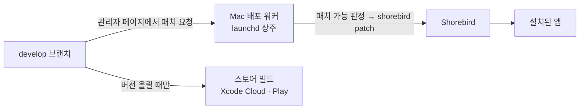

# 사주랑 — 1인 개발 모바일 앱 포트폴리오

**정확한 계산 위에 쉽고 재밌는 풀이를 얹은 사주(명리) 앱**을 기획부터 설계·개발·운영까지 혼자 맡아 만들고 있습니다.
Claude Code 에이전트로 **AI 개발 하네스**를 직접 설계해 4개월 동안 커밋 3,190개, 테스트 약 1만 2천 개 규모로 키웠습니다.

- 서비스 소개·베타 테스터 신청: https://sajurang.beomboo.com
- 앱 소스는 비공개입니다. 이 문서는 구조와 문제 해결 방법을 소개합니다.

  
  
  
  

홈 · 오늘의 점수 근거와 용어 말풍선 · 인맥 궁합도 · 이사 좋은 날 찾기 (모두 예시 데이터)

## 요약

- **역할**: 1인 개발 — 기획, 도메인 리서치, 아키텍처, Flutter 앱, 서버(Firebase), 배포 자동화, AI 개발 환경 설계
- **기간·상태**: 2026년 7월 ~ 진행 중, iOS·Android 베타 테스트 중(TestFlight·Google Play 테스트 트랙), 코드 푸시로 수시 업데이트
- **규모**: 앱 Dart 약 9.2만 줄(427개 파일), 테스트 약 24만 줄(663개 파일, 테스트 약 1만 2천 개), 문서로 고정한 계산 기준 91개
- **스택**: Flutter · Riverpod · GoRouter · Freezed · Firebase(Auth·Firestore·Hosting·Functions·Remote Config) · RevenueCat · Shorebird · Node.js · Claude Code

## 이 프로젝트에서 보여 줄 수 있는 것

- **도메인 정확성 설계** — 출처가 엇갈리는 도메인에서 "무엇을 정답으로 볼지"를 규칙으로 정하고, 그 규칙이 코드·문서·화면에서 어긋나지 않게 테스트로 묶었습니다.
- **테스트 전략** — 앱 코드의 2.6배 분량의 테스트, 전수 대조·시간대 불변성·문서 계약 테스트로 사람이 놓치는 버그를 찾았습니다.
- **모바일 아키텍처** — 기능별 계층 구조, 순수 함수 계산 엔진, 기기 우선 + 서버 미러, 익명 시작 → 계정 연결, 구독 결제.
- **배포·운영 자동화** — 관리자 웹 페이지와 상주 워커로 코드 푸시 배포 파이프라인을 직접 만들었습니다.
- **AI 에이전트 오케스트레이션** — 역할을 나눈 에이전트, 스스로 도는 개발 루프, 사람은 승인만 하는 대시보드. AI가 쓴 코드가 검증 없이 올라가지 못하게 막는 게이트를 설계했습니다.

## 문제 해결 사례

### 1. 출처가 엇갈리는 도메인에서 "정답"을 정하는 법

- **문제**: 같은 판정도 옛 원전·한국 실무서·인터넷 정리본이 서로 다르게 말합니다. 근거 없이 하나를 고르면 사용자마다 "다른 앱과 결과가 다르다"는 문의가 생기고, 나중에 고칠 근거도 남지 않습니다.
- **한 일**
  - 판정마다 기준 번호를 붙인 **계산 기준표**(현재 91개)를 만들고, 출처 위계를 정했습니다: 공식 천문 자료 → 한국 기준 → 원전 → 서로 독립된 출처 3곳 이상이 같은 "통용 기준" → 그래도 없으면 **판정하지 않음**.
  - 기준마다 출처·근거 구절·앱 코드 위치를 적고, 기준표의 코드 위치와 앱 안 "계산 기준 안내" 화면이 실제와 같은지 **테스트가 대조**하게 했습니다. 문서만 고치거나 코드만 고치면 빌드가 깨집니다.
  - 한국 기준과 원전 결과가 실제로 다른 사용자에게만 "기준에 따라 달라요 ⓘ"를 띄워 두 결과를 함께 보여 줍니다.
- **결과**: 계산 규칙을 바꿀 때마다 근거가 남고, 바뀌는 범위를 테스트로 고정한 뒤 그 밖의 결과는 전수 대조로 그대로인지 확인합니다(예: 1990~2030년 모든 날짜 × 택일 목적 3개).

### 2. 기기 시간대가 만든 버그를 테스트 구조로 찾기

- **문제**: 사주는 한국 시각 기준인데 기기는 어느 나라에 있든 될 수 있습니다. 서머타임이나 날짜변경선 근처에서는 같은 입력도 다른 결과가 나올 수 있습니다.
- **한 일**: 표준 검사 스크립트가 서울 외에 뉴욕·산티아고·로드하우(30분 서머타임)·아피아·키리티마티(UTC+14)로 시간대를 바꿔 같은 테스트를 다시 돌리게 했습니다.
- **결과**: "기기 시간대의 서머타임 시작일에 태어난 시간 02:30을 고르면 03:30으로 밀려 시주가 바뀌는" 버그를 찾았습니다. 시간 선택 휠이 '오늘' 날짜를 기준으로 시각을 만들던 것이 원인이었고, 공용 함수 한 곳만 고쳐 호출부 네 곳을 함께 고쳤습니다.

### 3. 외부 데이터를 믿지 않고 검증하기

- **문제**: 절기 시각이 1분만 틀려도 월주가 바뀝니다. 실제로 경쟁 앱이 절기 데이터를 잘못 입력했다가 정정한 사례가 있었습니다.
- **한 일**: 절기표를 한국천문연구원 원본 파일에서 스크립트로 생성하고, 원본 SHA-256과 생성 결과를 테스트로 고정했습니다. 1920~2100년 절입 시각 4,344개는 JPL 궤도 데이터로 따로 계산해 독립 대조했습니다.
- **결과**: 2060년까지는 모든 칸이 반올림 범위 안에서 맞았습니다. 2061년 이후의 최대 1분 차이는 미래 지구 자전 예측치(ΔT) 차이로 원인을 밝혀 문서에 남겼습니다.

### 4. 로그인 없이 시작해도 데이터를 잃지 않게

- **한 일**: 처음엔 Firebase 익명 계정으로 시작하고, 나중에 Apple·Google을 연결하면 같은 계정 ID로 이어지게 했습니다. 화면은 기기 데이터만 보고 그리고, Firestore에는 계정별 사본(미러)을 둬서 기기를 바꾸거나 다시 설치할 때 복원합니다.
- **결과**: 서버 문서 하나가 깨져도 그 문서만 건너뛰어 전체 복원이 실패하지 않습니다. 게스트도 바로 구독할 수 있고, 계정을 연결하면 구독이 함께 옮겨집니다(RevenueCat).

### 5. 혼자서도 안전하게 자주 배포하기

- **한 일**
  - `develop` 브랜치를 코드 푸시(Shorebird 패치)의 기준으로 두고, 패치로 보낼 수 없는 변경(네이티브·에셋·글꼴·버전)은 브랜치 규칙으로 막아 다음 스토어 빌드로 미뤘습니다.
  - 관리자 웹 페이지(Firebase Hosting)에서 패치를 요청하면, Mac에 상주하는 Node 워커가 Firestore 구독으로 요청을 받아 패치 가능 여부를 판정하고 빌드·배포·결과 기록까지 합니다. 판정 로직은 순수 모듈로 분리해 단위 테스트했습니다.
- **결과**: 스토어 심사 없이 버그 수정·문구 개선을 하루에도 여러 번 내보낼 수 있습니다.

## AI 개발 하네스 설계

혼자서 이 규모를 유지할 수 있었던 핵심입니다. AI가 코드를 많이 쓰게 하는 것보다, **틀린 코드가 올라가지 못하게 막는 장치**와 **사람의 결정이 다음 세션까지 이어지는 구조**에 집중했습니다.

### 구성 요소

- **규칙 파일** — 저장소 루트 `CLAUDE.md`에 규칙 19개를 둡니다. 모든 세션과 에이전트가 먼저 읽습니다. 예: 같은 입력이면 같은 결과, 계산 기준은 출처 위계를 따름, UI 변경은 변경 전·예정 스크린샷을 남김, 첫 화면 문장은 초등학생도 알아듣게, 태블릿·폴더블에서는 넓은 화면을 살린 배치. 사용자가 방향을 바꾸면 규칙 자체를 고쳐서 다음 세션이 같은 실수를 하지 않게 합니다.
- **역할을 나눈 에이전트 4종**
  - planner(읽기 전용): 요구사항 분석, 코드 지도에서 경로 찾기, 리팩터링 후보 탐색
  - developer: 구현과 고친 부분의 테스트·린트까지, 커밋은 하지 않음
  - tester: "일부러 되돌려 실패를 확인하고, 다시 고쳐 통과를 확인"하는 절차로 테스트를 보강해 통과만 하는 테스트를 막음
  - researcher: 원전·공식 자료·경쟁 앱 조사, 앱 코드는 절대 수정하지 않음
  - 에이전트끼리는 서로 부르지 않고, 메인 세션만 결과를 넘기고 검증·커밋합니다.
- **스스로 도는 개발 루프** — 메인 세션이 한 사이클을 마치면 다음 사이클을 스스로 예약합니다. 사람의 회신 확인 → 승인된 작업 처리 → 할 일이 없으면 리팩터링 탐색과 리서치를 번갈아 → 검증 게이트 통과 시에만 기능 단위로 커밋·푸시 → 대시보드에 기록. 둘 다 낼 것이 없을 때만 쉬고 Slack으로 알립니다.
- **검증 게이트** — `check_build.sh` 하나가 의존성 → 코드 생성 → 린트 → 포맷 → 여러 시간대 테스트 → 빌드 → 산출물 확인을 돌리고, 루프는 `검사 성공 && 커밋 && 푸시`로만 씁니다.
- **사람의 창구, 작업 대시보드** — 공유 데이터베이스가 붙은 웹 페이지 한 곳에서 사람과 루프가 만납니다. 사람은 시안 스크린샷을 보고 승인·반려만 누르고, 루프는 끝난 항목에 결과 한 줄과 커밋 해시를 남겨 그대로 이력이 됩니다. "승인 절차" 스위치로 루프에 얼마나 맡길지 정하고, 가격·무료 범위 같은 사업 결정은 언제나 사람이 정합니다.

### 실패에서 만든 규칙

하네스는 처음부터 완성된 게 아니라, 루프가 실패할 때마다 원인을 규칙으로 바꿔 왔습니다.

- 리서치 커밋이 빌드를 깨뜨림 → 리서치가 계산 기준표를 고치면 문서 대조 테스트를 반드시 돌린다
- 에이전트가 다른 Flutter 버전으로 테스트를 돌려 빌드 캐시가 꼬임 → 모든 지시문에 SDK 경로를 고정하고, 메인 검증 중에는 테스트를 돌리지 않는다
- 대시보드 상태값이 정해진 값을 벗어나 항목이 목록에서 사라짐 → 매 사이클 끝나지 않은 항목 전체를 읽어 상태를 바로잡는다
- 할 일이 없다며 루프가 계속 쉼 → 쉬기 전에 리팩터링과 리서치를 먼저 소진한다
- 탐색 에이전트가 "안 쓰는 코드"라고 잘못 짚음 → 구현 에이전트가 지우기 전에 호출부를 다시 확인하고, 틀리면 하지 않고 보고한다
- 리서치가 이미 사람이 내린 결정과 반대되는 제안을 냄 → 기록된 사용자 결정과 부딪히면 루프는 바꾸지 않고 기록만 남긴다

### 리서치도 코드처럼

도메인 리서치 문서마다 "최종 확인" 날짜를 두고, 오래된 문서부터 원전·공식 자료로 다시 확인합니다. 리서치 결과는 정해진 형식의 커밋 메시지로 남기고, 앱 계산과 다른 점을 찾으면 그대로 작업 후보가 됩니다. 예: 택일의 복단일 기준 반영, 이름 한자의 두음 표기 규정 반영, 2026년 10월 Apple 심사 지침 개정(숨긴 기능 금지)에 맞춘 심사 노트 갱신.

## 회고

- AI와 일할 때 가장 오래 남는 자산은 코드가 아니라 **규칙·검증 게이트·결정 기록**이었습니다. 이것이 있어야 세션이 바뀌어도 품질이 유지됩니다.
- "정답이 엇갈리는 도메인"에서는 정답을 고르기보다 **정답을 고르는 절차**를 먼저 정하는 것이 오래 버텼습니다.
- 테스트를 앱 코드보다 많이 쓴 것이 오히려 속도를 냈습니다. 루프가 밤새 리팩터링해도 결과가 바뀌지 않았다는 걸 테스트가 증명해 주기 때문입니다.
