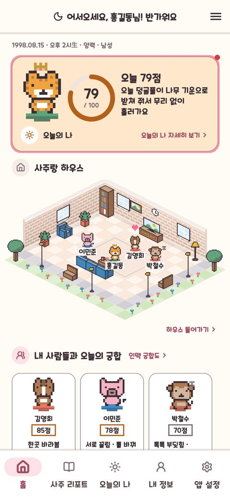
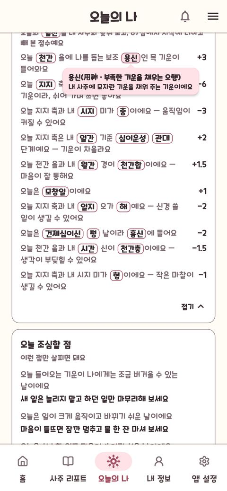
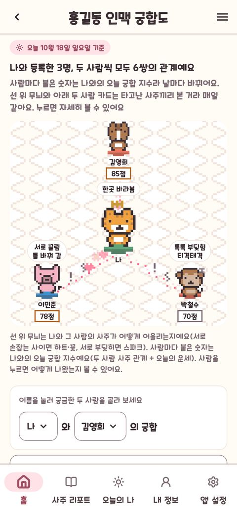
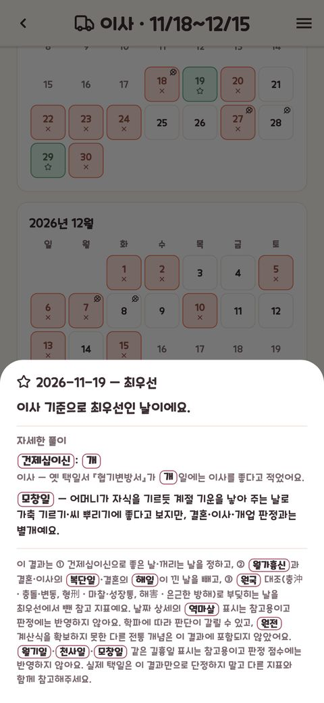
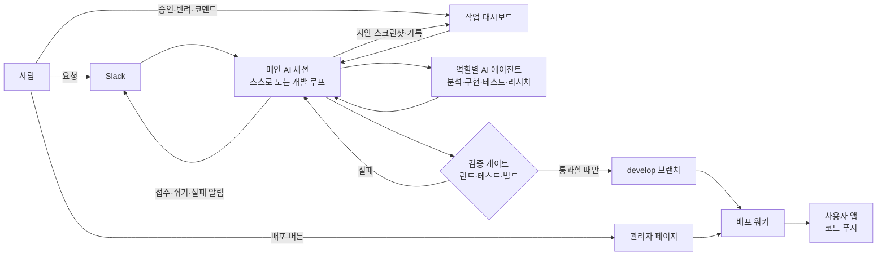
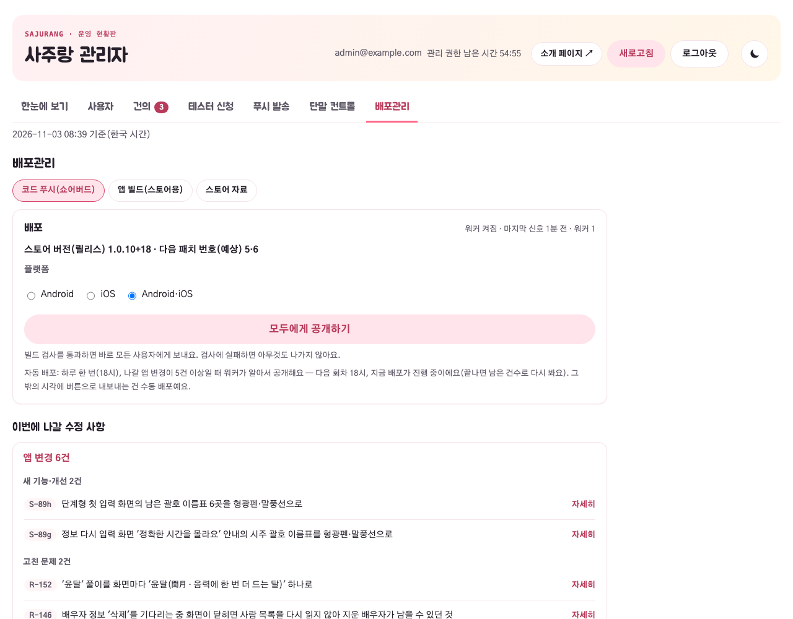

# 사주랑 — AI와 함께 만든 1인 개발 앱

혼자서 AI 에이전트(Claude Code)와 함께 사주 앱을 기획부터 출시 준비까지 만들고 있습니다.
**"AI가 빠르게 만들고, 시스템이 검증하고, 사람은 결정한다"**는 원칙으로 개발 환경 자체를 설계했습니다.

  
  
  
  

서비스 소개·베타 신청: https://sajurang.beomboo.com · 앱 소스는 비공개

## 한눈에

- **무엇을** — 생년월일시로 사주를 계산해 리포트·오늘의 운세·궁합·좋은 날 찾기를 보여 주는 iOS·Android 앱(베타 테스트 중)
- **누가** — 1인 개발(기획·설계·개발·서버·배포), 구현의 대부분은 AI 에이전트
- **얼마나** — 4개월, 커밋 3,190개, 앱 코드 9.2만 줄, 테스트 코드 24만 줄(테스트 약 1만 2천 개)
- **무엇으로** — Flutter · Firebase · RevenueCat(구독) · Shorebird(코드 푸시) · Claude Code

## 바이브코딩을 대하는 마인드

### 1. AI의 속도는 믿고, AI의 결과는 믿지 않는다
AI가 쓴 코드는 사람이 아니라 **자동 검증 게이트**가 통과시킵니다. 린트·테스트·빌드를 한 번에 돌리는 스크립트를 통과해야만 커밋·배포되도록 묶었습니다. 그래서 테스트가 앱 코드보다 2.6배 많습니다.

### 2. 실행은 AI가, 결정은 사람이
AI는 스스로 다음 작업을 예약하며 밤새 돌아갑니다. 화면이 바뀌는 작업은 **변경 전·후 스크린샷**을 대시보드에 올리고, 사람은 보고 **승인·반려만** 누릅니다. 가격 같은 사업 결정은 언제나 사람이 합니다.

### 3. 실수는 한 번만 — 실패는 규칙이 된다
AI가 실수하면 고치는 데서 끝내지 않고, 원인을 **규칙 파일**(현재 19개 조항)에 적습니다. 모든 AI 세션이 이 파일을 먼저 읽기 때문에, 같은 실수는 다음 세션에서 반복되지 않습니다.

### 4. 한 AI에게 다 시키지 않는다
분석(읽기 전용) · 구현 · 테스트 · 리서치(코드 수정 금지)로 **역할과 권한을 나눈 에이전트 4개**를 두고, 메인 세션 하나만 검증하고 커밋합니다. 테스트 담당은 "일부러 코드를 망가뜨려 테스트가 실패하는지"까지 확인합니다.

### 5. 정확성은 협상하지 않는다
출처가 엇갈리는 분야라서, AI가 그럴듯한 답을 지어내지 못하게 **근거 순서**를 정했습니다: 공식 자료 → 한국 기준 → 원전 → 독립 출처 3곳 이상 → 그래도 없으면 판정하지 않음. 판정 기준 91개를 문서로 고정하고, 문서와 코드가 어긋나면 테스트가 실패합니다.

## 설계 한 장

## 운영을 받치는 세 가지 도구

사람이 개발 환경을 직접 열지 않아도 앱을 운영하고 AI에게 일을 시킬 수 있도록, 창구 세 개를 직접 만들었습니다.

### 관리자 페이지 — 직접 만든 운영 콘솔

- 탭 6개: 사용자 · 건의(답변) · 테스터 신청 · 푸시 발송 · 단말 컨트롤 · 배포관리
- **배포관리** — 버튼 하나로 코드 푸시를 요청하면 Mac에 상주하는 워커가 검사·빌드·배포·결과 기록까지 합니다. 나갈 변경이 쌓이면 하루 한 번 워커가 알아서 내보냅니다.
- **단말 컨트롤** — 앱을 다시 내지 않고 업데이트 안내·강제 업데이트·무료 인원 한도를 바꿉니다(Remote Config).
- **보안** — 관리 권한은 시간이 지나면 끝나고, 모든 열람·작업을 기록으로 남깁니다.

### 작업 대시보드 — 사람과 AI의 결재판

- AI가 올린 시안을 **변경 전·후 스크린샷**으로 보고 승인·반려를 누릅니다.
- 궁금한 점은 코멘트로 물으면 AI가 같은 자리에 답하고, 메모로 남긴 요청은 AI가 작업으로 등록합니다.
- AI는 사이클마다 한 일·스스로 내린 결정과 그 이유·실패를 기록하고, 리서치 결과는 따로 모읍니다. 끝난 항목은 지우지 않고 결과와 커밋을 남겨 그대로 이력이 됩니다.
- "승인 절차" 스위치로 AI에게 얼마나 맡길지 정합니다.

### Slack 연동 — 어디서든 일 시키기

- 휴대폰에서 Slack으로 요청을 보내면, AI 루프가 받아 작업으로 등록하고 접수 확인을 답합니다.
- AI가 쉬기 시작하거나 실패하면 알림이 옵니다. 회신을 기다리는 시안이 있으면 대시보드 링크도 함께 옵니다.
- 웹에서 테스터 신청이 들어오면 바로 알림이 오고, 관리자 페이지에서 Slack 읽기·보내기를 켜고 끕니다.

## 이렇게 만든 결과

- **사람이 놓칠 버그를 시스템이 찾았습니다** — 여섯 나라 시간대로 같은 테스트를 돌리다가 "기기 시간대의 서머타임 시작일에 태어난 시간 02:30이 03:30으로 밀리는" 버그를 찾아 고쳤습니다.
- **혼자서도 스토어 심사 없이 수시로 안전하게 배포합니다** — 관리자 페이지에서 요청하면 상주 워커가 배포 가능 여부를 판정하고 코드 푸시까지 합니다.
- **AI가 밤새 코드를 정리해도 결과가 바뀌지 않습니다** — 테스트가 그것을 증명하기 때문에 리팩터링을 두려워하지 않습니다.

> AI와 일할 때 가장 오래 남는 자산은 코드가 아니라 **규칙 · 검증 게이트 · 결정 기록**이었습니다.
